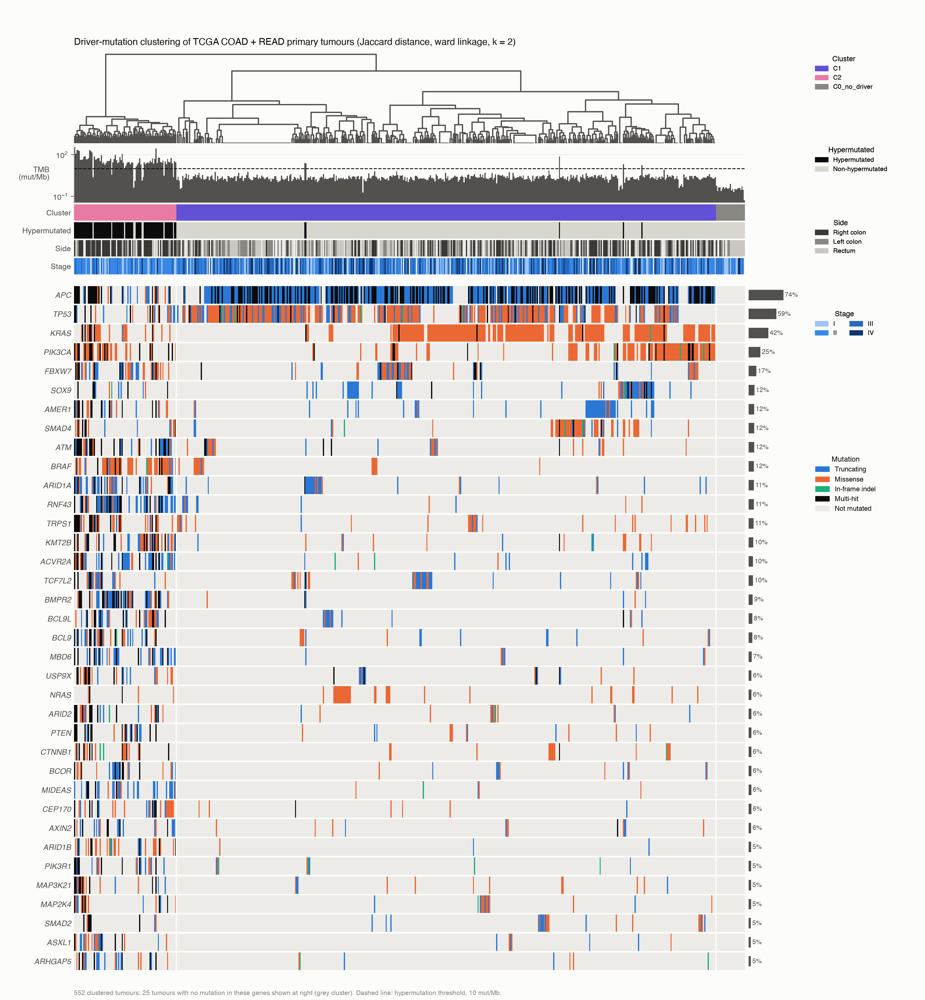
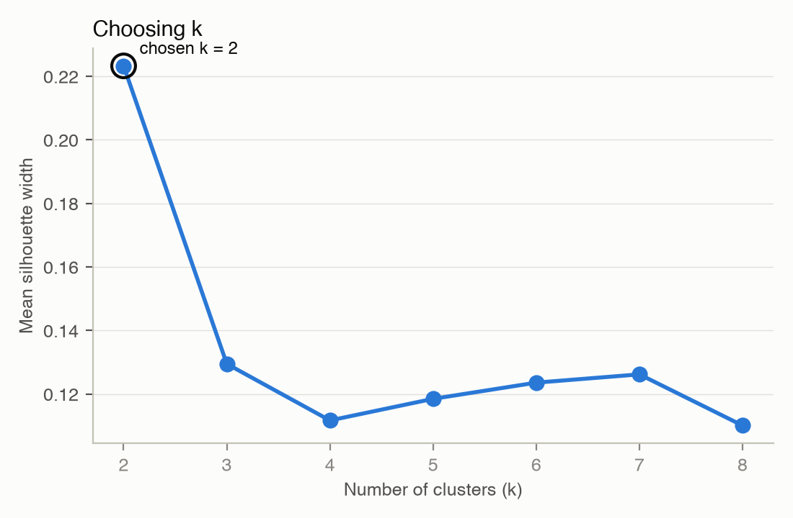
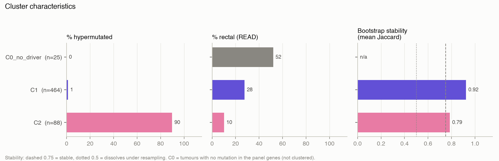
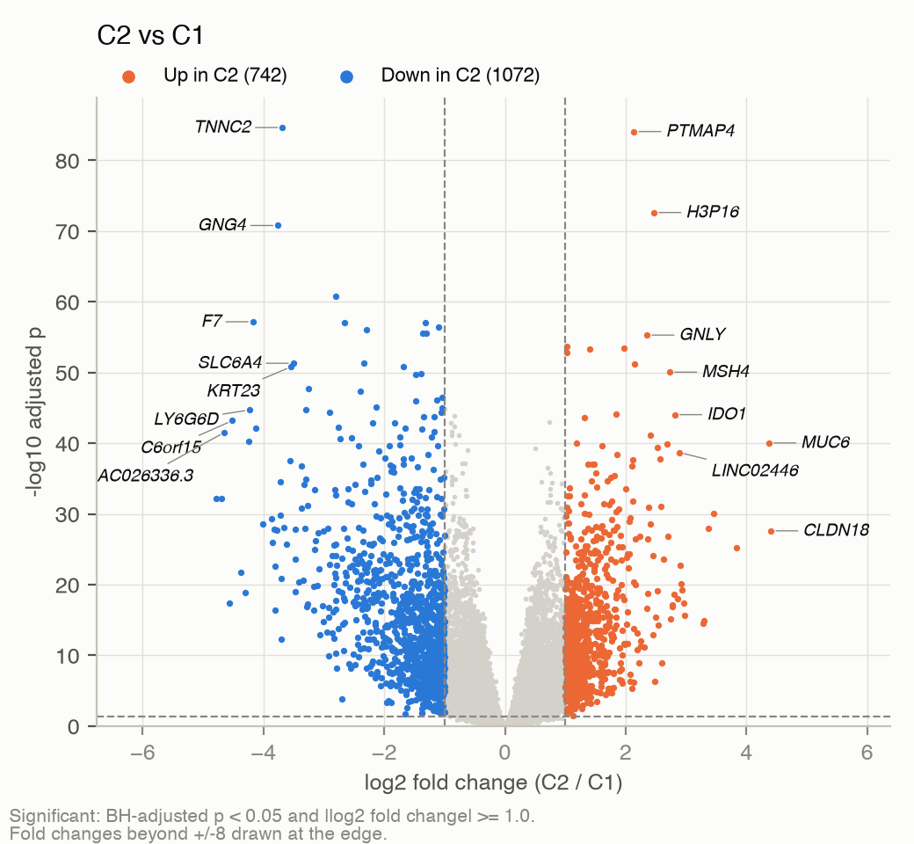
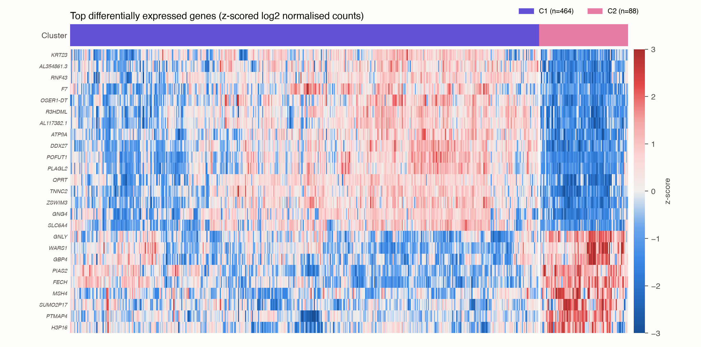
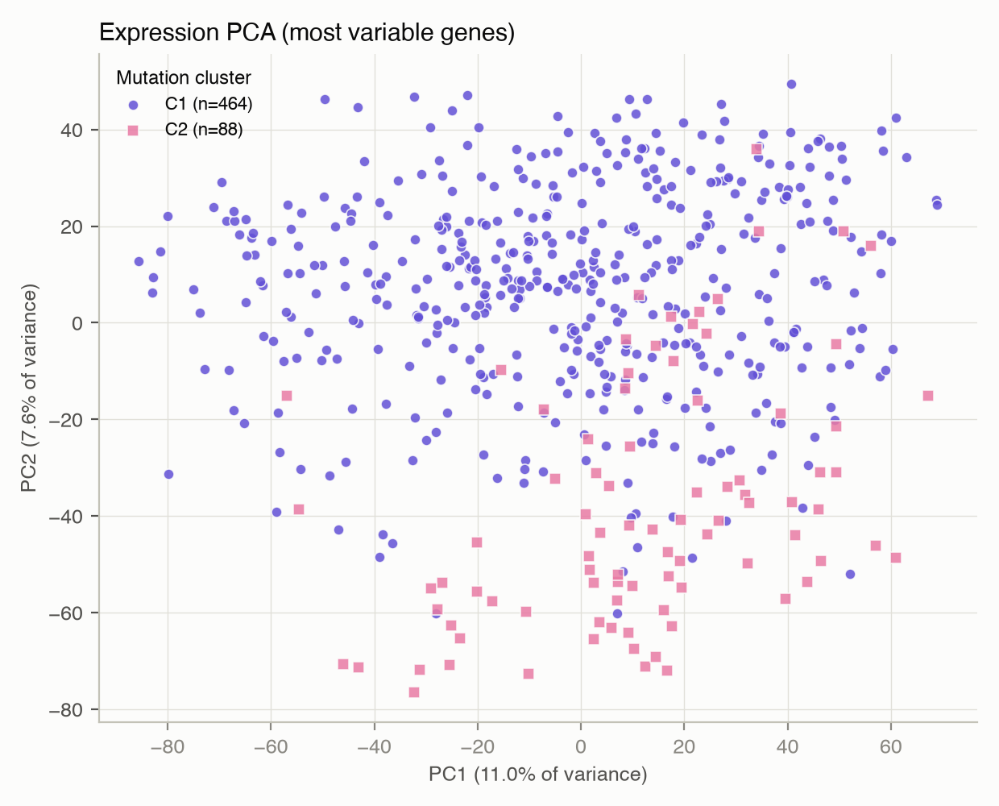

# Driver-mutation clusters in colorectal cancer

TCGA colon (COAD) and rectal (READ) tumours are clustered by which driver genes are mutated, and gene expression is then compared between the groups. Numbers in the tables are read from this run's outputs.

- [Main finding](#main-finding)
- [1. Mutation matrix](#1-mutation-matrix)
- [2. Hierarchical clustering](#2-hierarchical-clustering)
- [3. Count preparation](#3-count-preparation)
- [4. Differential expression](#4-differential-expression)
- [Limitations](#limitations)
- [References](#references)
- [Software](#software)

## Main finding

**Cluster C2 is the hypermutated group.** With k = 2 the tumours split into a large, mostly non-hypermutated cluster (C1) and a smaller hypermutated cluster (C2). Before running this experiment, I decided that I wanted clusters to have a stability of atleast 0.75. The expression analysis is a single comparison, C2 against C1.

The separation is weak in absolute terms as you can see in the silhouette scores, and a hypermutated group in colorectal cancer is already well known. 

## 1. Mutation matrix

Masked somatic mutations are turned into a patient by gene table of 0 (not mutated) and 1 (at least one protein altering mutation). Only genes on a colorectal driver panel [1] are used, because in an unrestricted matrix long genes are mutated often by chance. The panel contains oncogenes and tumour suppressors

| Step | Tumours |
| --- | --- |
| Tumour samples in the mutation files | 596 |
| Primary tumours | 593 |
| One sample per patient | 582 |
| After the RNA-seq requirement | 577 |
| After the hypermutation filter | 577 |
| Clustered (at least one kept driver gene mutated) | 552 |
| Set aside with no kept driver gene mutated (C0) | 25 |

36 of 109 panel genes passed the frequency filter; 84 tumours are hypermutated.

## 2. Hierarchical clustering

**Distance.** Jaccard distance is 1 minus (genes mutated in both tumours / genes mutated in either). It ignores genes that neither tumour has mutated, which suits a matrix that is mostly zeros. It carries no information for a tumour with no mutated genes, so those tumours form a separate group, C0, and are not clustered.

**Linkage.** Clustering starts with each tumour alone and repeatedly merges two groups. Ward linkage merges the pair that least increases within-group variance, giving compact groups.

**Silhouette.** For each tumour, `(b - a) / max(a, b)`, where a is the mean distance to its own cluster and b to the nearest other cluster.  k = 2 in this run.

**Stability.** Tumours are resampled with replacement and reclustered 200 times (repeated draws of a tumour are used once). For each cluster, the Jaccard overlap with its best match is averaged. I used the protocol that above 0.75 stable, 0.6 to 0.75 a pattern with uncertain membership.

**Gene and clinical tests.** Fisher's exact test per gene (cluster against the other clusters, Benjamini-Hochberg adjusted) and chi-square tests for clinical variables. 

### Hyperparameters

| Parameter | Value | Why this value |
|---|---|---|
| linkage | ward | Gave groups large enough to compare. |
| k | 2 | Selected by silhouette.  |

### Results

| cluster | n | pct_hypermutated | pct_READ | stability |
| --- | --- | --- | --- | --- |
| C0_no_driver | 25 | 0.0 | 52.0 | n/a |
| C1 | 464 | 1.1 | 27.6 | 0.924 |
| C2 | 88 | 89.8 | 10.2 | 0.786 |

| variable | n | chi2 | dof | p_value |
| --- | --- | --- | --- | --- |
| hypermutated | 552 | 444.19 | 1 | 1.3e-98 |
| side | 449 | 41.3 | 2 | 1.1e-09 |
| READ or COAD | 552 | 11.03 | 1 | 0.00089 |
| stage | 530 | 30.78 | 3 | 9.4e-07 |

*Oncoprint - columns are tumours in dendrogram order and rows are genes. Pale cells are unmutated or unknown.*

*Mean silhouette for each number of clusters and the circled value was used.*

*Cluster composition and bootstrap stability.*

## 3. Count preparation

Expression is stored as log2(count + 1) and is converted back to integer counts as the DESeq2 model requires. Low-count genes are removed, tissue source site which is read from the TCGA barcode is recorded as a batch variable.

21,901 of 60,616 genes were kept (>= 10 counts in >= 88 tumours (smallest cluster)); 552 tumours; 18 site levels.

## 4. Differential expression

PyDESeq2 (a Python implementation of DESeq2) is used. One model, `~ batch + cluster`, is fitted to all clustered tumours and the clusters are compared pairwise. P-values are Benjamini-Hochberg adjusted. Fold changes are not shrunken.

### Results

C2_vs_C1 compares the hypermutated cluster with the other clustered tumours; positive fold changes are higher in C2.

| contrast | genes_tested | padj_below_alpha | significant | up | down |
| --- | --- | --- | --- | --- | --- |
| C2_vs_C1 | 21887 | 12892 | 1814 | 742 | 1072 |

*Volcano plots. Dashed lines are the cutoffs and labelled genes have the largest combined significance and fold change.*

*Top 25 genes by adjusted p-value per comparison, z-scored log2 normalised counts.*

*PCA of the 2000 most variable genes, log2 normalised counts .*

## Limitations

- Silhouette and stability show overlapping groups
- C1 is a broad group: no further split of it was stable so differences within it are not analysed.
- A high stability score is easier to reach for a cluster that holds most of the tumours and unfortunately C1 does.
- C2 reflects mutation burden as well as specific drivers

## References

1. Nunes L, Li F, Wu M, et al. Prognostic genome and transcriptome signatures in colorectal cancers. *Nature* 633, 137-146 (2024). https://doi.org/10.1038/s41586-024-07769-3

## Software

| Package | Version |
| --- | --- |
| numpy | 2.5.4 |
| pandas | 2.3.3 |
| scipy | 1.18.1 |
| scikit-learn | 1.9.1 |
| statsmodels | 0.15.0 |
| pydeseq2 | 0.5.4 |
| matplotlib | 3.11.2 |
