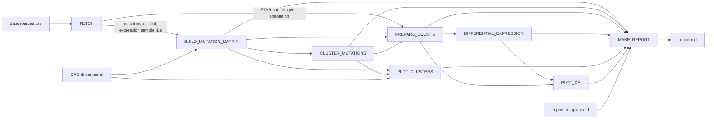

# Resubtyping Colorectal Cancer

A Nextflow pipeline that groups TCGA colorectal tumours by their driver-gene mutations and then compares gene expression between the groups.

BIOF 501 final project

- [Background](#background)
- [Question and rationale](#question-and-rationale)
- [Pipeline](#pipeline)
- [Data](#data)
- [Dependencies](#dependencies)
- [How to run](#how-to-run)
- [Expected results](#expected-results)
- [Directory structure](#directory-structure)
- [Limitations](#limitations)
- [References](#references)

## Background

Colorectal cancer (CRC) is a leading cause of cancer-related death worldwide, and patients differ widely in outcome and drug response. Tumours are commonly subtyped with the consensus molecular subtypes (CMS), which are predicted from gene expression by a machine learning model [1].

| Subtype | Typical features |
|---|---|
| CMS1 | High microsatellite instability (MSI), right-sided, immune activation |
| CMS2 | Low MSI, high chromosomal instability (CIN), left-sided, WNT signalling |
| CMS3 | More frequent KRAS mutation, low CIN, mixed MSI status |
| CMS4 | Low MSI, high CIN, TGF-beta and integrin signalling |

The CMS work provides two classifiers, a random forest (RF) and a single sample predictor (SSP). In a comparison of 100 TCGA patients, the two often disagreed on the same patient, and changing the hyperparameters also changed the calls. This incongruency is the motivation for creating new subtyping.

## Question and rationale

**Can clustering somatic mutations, then interpreting the clusters by differential expression, give more reliable CRC subtypes?**

Expression-based calls depend on normalisation and on the cohort used for centring. Whether a driver gene is mutated is a simpler binary measurement, so it is a reasonable alternative basis for grouping tumours. Expression is then used to interpret the groups rather than to define them.

| Design choice | Reason |
|---|---|
| Nextflow | The whole analysis is automated and repeatable on another device. |
| Driver-gene panel [2] | In an unrestricted matrix long genes are often mutated by chance. |
| Jaccard distance | As matrix is quite sparse it ignores genes that neither tumour has mutated. |
| Ward linkage | Gave groups large enough to compare as average linkage mostly split off single tumours. |
| Silhouette and bootstrap | Measure separation and reproducibility which are important properties for creating subtypes |
| PyDESeq2 with a site covariate | Models counts directly and adjusts for TCGA collection site. |

## Pipeline



| Stage | What it does | Output folder |
|---|---|---|
| `FETCH` | Downloads each file and checks its md5 | `data/raw` |
| `BUILD_MUTATION_MATRIX` | Keeps one primary tumour per patient with RNA-seq then builds a binary oncogene matrix of protein-altering mutations | `01_mutation_matrix` |
| `CLUSTER_MUTATIONS` | Hierarchical clustering with silhouette scores for k = 2 to 8. 200 bootstrap resamples are ran to assess stability | `02_clustering` |
| `PLOT_CLUSTERS` | Oncoprint and cluster figures | `05_report/figures` |
| `PREPARE_COUNTS` | Converts log2(count + 1) back to integer counts and removes low-count genes | `03_counts` |
| `DIFFERENTIAL_EXPRESSION` | PyDESeq2, `~ batch + cluster`, Benjamini-Hochberg adjusted | `04_differential_expression` |
| `PLOT_DE` | Volcano plot, heatmap, PCA and gene counts | `05_report/figures` |
| `MAKE_REPORT` | Fills the template with this run's numbers and embeds the figures in one HTML file | `05_report` |

## Data

All data are public TCGA COAD (colon) and READ (rectum) files, downloaded automatically from the UCSC Xena GDC hub. The total download is about 81 MB. URLs and md5 checksums are in [data/sources.csv](data/sources.csv).

| Data | Contents | Format | Size |
|---|---|---|---|
| Somatic mutations | Whole-exome masked calls, one row per mutation per tumour | MAF-like table, `.tsv.gz` | 7.95 MB |
| Gene expression | STAR counts stored as log2(count + 1), genes x samples | Matrix, `.tsv.gz` | 70.05 MB |
| Clinical | Stage, tumour site and survival fields | Table, `.tsv.gz` | 0.17 MB |
| Gene annotation | GENCODE v36 Ensembl ID to symbol map | Text | 3.21 MB |

The driver panel of 109 genes ([data/crc_driver_genes.tsv](data/crc_driver_genes.tsv), from [2]) is included in the repository. These data suit the question because mutations and expression were measured in the same tumours.

| Selection step | Tumours |
|---|---:|
| In the mutation files | 596 |
| Primary tumours | 593 |
| One sample per patient | 582 |
| With RNA-seq | 577 |
| Clustered (at least one kept driver gene mutated) | **552** |

The 25 tumours with no kept driver mutation are set aside as `C0_no_driver`.

## Dependencies

**Core (you install these):** Nextflow 24.04 or newer (tested with 26.04.7; the install below includes Java) and conda.

**Pipeline (Nextflow installs these through conda and you can see the versions in [envs/environment.yml](envs/environment.yml)):**

| Tool | Version | Used for |
|---|---|---|
| Python | 3.12.16 | All stages |
| NumPy, pandas | 2.5.4, 2.3.3 | Data handling, bootstrap resampling |
| SciPy | 1.18.1 | Hierarchical clustering, statistical tests |
| scikit-learn | 1.9.1 | Silhouette score |
| statsmodels | 0.15.0 | Multiple-testing correction |
| PyDESeq2, anndata | 0.5.4, 0.13.4 | Differential expression |
| Matplotlib | 3.11.2 | Figures |
| Markdown | 3.11.3 | HTML report |

## How to run


**1. Install conda**

**2. Install nextflow** :

```bash
conda create -n nextflow --override-channels -c conda-forge -c bioconda nextflow
conda activate nextflow
nextflow -version
```

**3. Download the code from the repo:**

```bash
git clone https://github.com/ghazalfa/crc_analysis
cd crc_analysis
```

**4. Run the nextflow model:**

```bash
nextflow run main.nf
```

**5. Open the report**, `results/05_report/report.md`, in any markdown viewer!

### Options

Defaults are in [nextflow.config](nextflow.config) but they can be overriden in command line

| Option | Default | Meaning |
|---|---|---|
| `--k` | 2 | Number of clusters; 0 picks k by silhouette |
| `--min_freq` | 0.05 | Minimum mutation frequency for a panel gene |
| `--outdir` | results | Output folder |

## Expected results

The exact report that is expected from the generated report when using the default settings are in [expected_results/](expected_results/). Below I've listed some of the big takeaways of the expected result but for validating the models output please use that report.

| Stage | Output in `results/` | Expected value | Reference copy |
|---|---|---|---|
| `BUILD_MUTATION_MATRIX` | `01_mutation_matrix/build_summary.json` | 577 tumours, 36 of 109 panel genes kept, 84 hypermutated | [build_summary.json](expected_results/build_summary.json) |
| `CLUSTER_MUTATIONS` | `02_clustering/cluster_summary.tsv` | C1 = 464, C2 = 88, C0 = 25 | [cluster_summary.tsv](expected_results/cluster_summary.tsv) |
| `CLUSTER_MUTATIONS` | `02_clustering/cluster_stability.tsv` | C1 = 0.924, C2 = 0.786 | [cluster_stability.tsv](expected_results/cluster_stability.tsv) |
| `CLUSTER_MUTATIONS` | `02_clustering/k_selection.tsv` | Silhouette 0.2233 at k = 2 | [k_selection.tsv](expected_results/k_selection.tsv) |
| `PREPARE_COUNTS` | `03_counts/prepare_counts_summary.json` | 552 tumours, 21,901 of 60,616 genes | [prepare_counts_summary.json](expected_results/prepare_counts_summary.json) |
| `DIFFERENTIAL_EXPRESSION` | `04_differential_expression/de_summary.tsv` | 1,814 genes: 742 up and 1,072 down in C2 | [de_summary.tsv](expected_results/de_summary.tsv) |
| `MAKE_REPORT` | `05_report/report.md` | Markdown report with 8 figures | [report.md](expected_results/report.md) |

### Two stable but weakly separated clusters

| Cluster | Tumours | Stability (mean Jaccard) | Hypermutated |
|---|---:|---:|---:
| C1 | 464 | 0.924 | 1.1% | 
| C2 | 88 | 0.786 | 89.8% | 


## Directory structure

```text
.
├── main.nf                      # workflow
├── nextflow.config              # parameters and conda settings
├── envs/environment.yml         # pinned software
├── src/
│   ├── fetch_file.py            # FETCH
│   ├── build_mutation_matrix.py # BUILD_MUTATION_MATRIX
│   ├── cluster_mutations.py     # CLUSTER_MUTATIONS
│   ├── plot_clusters.py         # PLOT_CLUSTERS
│   ├── prepare_counts.py        # PREPARE_COUNTS
│   ├── differential_expression.py # DIFFERENTIAL_EXPRESSION
│   ├── plot_de.py               # PLOT_DE
│   ├── make_report.py           # MAKE_REPORT
│   └── plot_style.py            # shared figure style
├── templates/report_template.md # report template: wording only; the filled report is results/05_report/report.md
├── data/
│   ├── sources.csv              # download URLs and md5
│   ├── crc_driver_genes.tsv     # driver panel
│   └── raw/                     # downloads (created by the run)
├── expected_results/            # reference outputs
├── results/                     # outputs (created by the run)
│   ├── 01_mutation_matrix/
│   ├── 02_clustering/
│   ├── 03_counts/
│   ├── 04_differential_expression/
│   ├── 05_report/
│   └── pipeline_info/           # runtime, timeline and DAG
└── work/                        # Nextflow cache and conda environments (created by the run)
```

## Gen AI Disclosure
Claude Opus was heavily used for writing the code in this project. All of the design choices such as deciding on statistical tests, figure choice, models used in the pipeline, and hyperparameter selection was made by the student, however the code was almost exclusively written by Claude.

## References

1. Guinney J, et al. The consensus molecular subtypes of colorectal cancer. *Nature Medicine* 21, 1350-1356 (2015). https://doi.org/10.1038/nm.3967
2. Nunes L, et al. Prognostic genome and transcriptome signatures in colorectal cancers. *Nature* 633, 137-146 (2024). https://doi.org/10.1038/s41586-024-07769-3
3. Hennig C. Cluster-wise assessment of cluster stability. *Computational Statistics & Data Analysis* 52, 258-271 (2007). https://doi.org/10.1016/j.csda.2006.11.025
